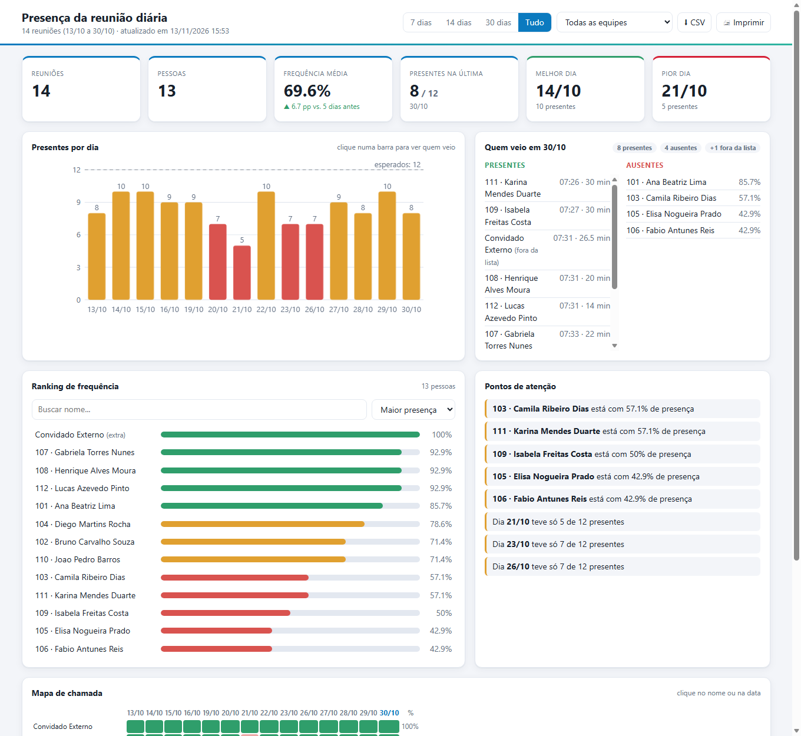

# Teams Attendance Report

Automatiza a lista de chamada de uma reunião diária do Microsoft Teams: lê os relatórios de presença (CSV), consolida
tudo numa planilha Excel, gera um painel de frequência e, se você quiser, envia o resumo por e-mail (Outlook) para
cada supervisor.

> Projeto feito em **13/11/2026**. Os dados da captura abaixo e da pasta `exemplo/` são fictícios.



## O que faz
- Lê os dois formatos de relatório do Teams: lista de participantes e registro de eventos (Ingressou/Saiu).
- Reconhece nomes informais do Teams ("ana", "Bruno") contra a lista oficial, com um relatório de conferência.
- Gera `Presenca_Consolidada.xlsx` (Resumo, Chamada P/F por dia e Detalhe) e `painel.html`.
- Painel interativo: filtro por período e equipe, gráfico clicável por dia, ranking, mapa de chamada, pontos de atenção e exportação CSV.
- Envia, via Outlook, dois e-mails por supervisor (reunião do dia e média do mês) com PDF anexo, mais um painel geral.

## Como usar
```bash
pip install -r requirements.txt

# 1) experimente com os dados de exemplo
copy equipes.exemplo.csv equipes.csv
python consolidar_presenca.py --pasta exemplo/presencas      # gera a pasta saida/

# 2) com seus dados: coloque os CSVs do Teams em presencas/ e preencha equipes.csv
python consolidar_presenca.py
```

### Envio por e-mail (opcional, Windows + Outlook clássico)
```bash
python enviar_emails.py                                  # abre RASCUNHOS no Outlook (nada é enviado)
python enviar_emails.py --teste-para voce@empresa.com    # manda tudo para você, com [TESTE]
python enviar_emails.py --enviar                         # envia de verdade
python enviar_emails.py --auto                           # modo agendado: só envia se houver o CSV de hoje
```
Defina `PRESENCA_EMAIL_GERAL` para receber também o painel geral. O PDF é gerado pelo Microsoft Edge (headless).
Para rodar todo dia útil, agende `python enviar_emails.py --auto` no Agendador de Tarefas do Windows.

## Arquivos
| Arquivo | Função |
|---|---|
| `consolidar_presenca.py` | lê os CSVs, reconhece nomes, gera Excel e painel |
| `enviar_emails.py` | PDFs por equipe e envio pelo Outlook |
| `painel_template.html` | painel (HTML/JS puro, sem dependências) |
| `equipes.exemplo.csv` | modelo: `Nome;Email;Supervisor;EmailSupervisor;Codigo` |
| `apelidos.csv` (opcional) | `nome no Teams;nome oficial` (ou `IGNORAR`) para casos ambíguos |

Dados reais (`presencas/`, `saida/`, `equipes.csv`) ficam fora do git pelo `.gitignore`.

## Stack
Python 3, openpyxl, pywin32, HTML/CSS/JS sem frameworks.
